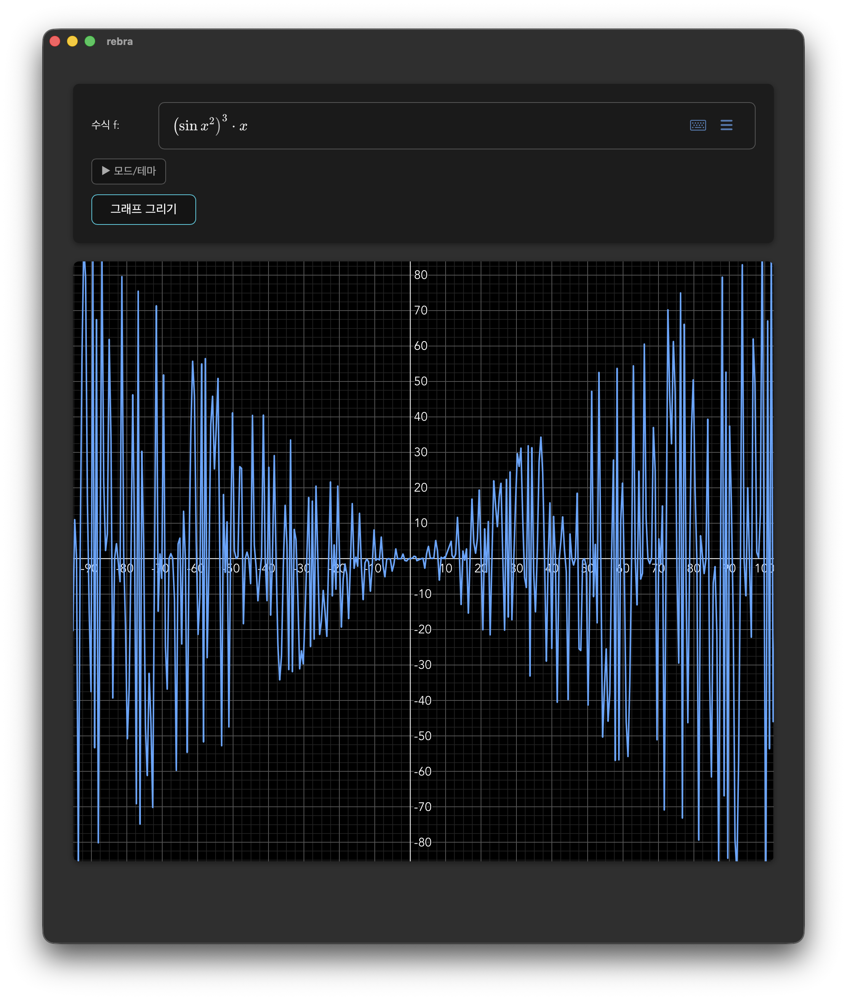
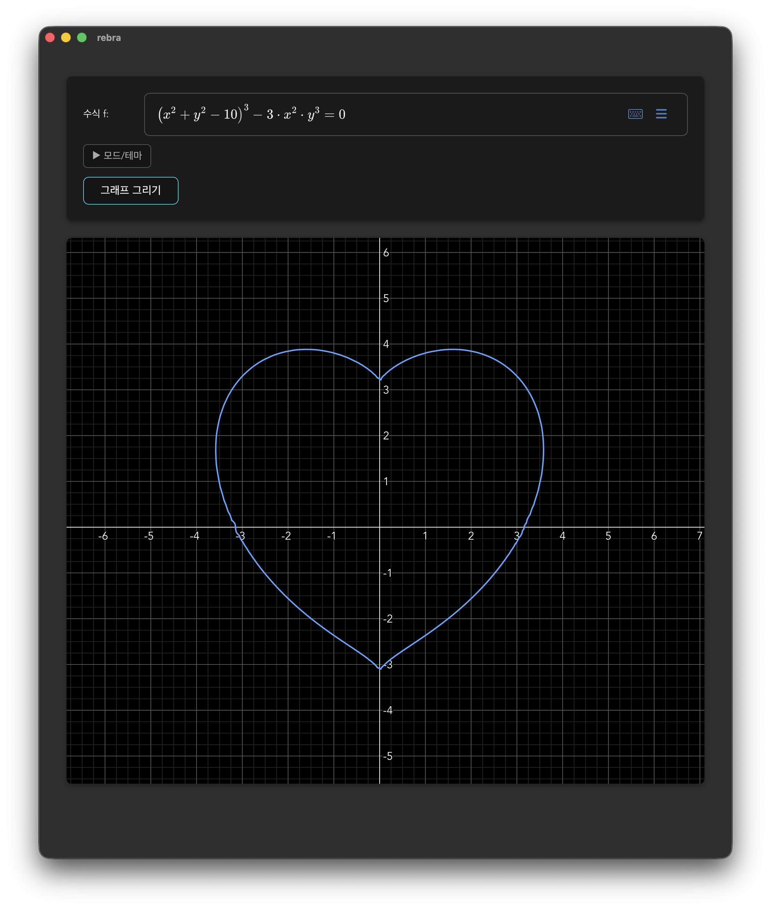

<p align="center">
  <strong>🌐 언어 / Language</strong><br>
  <a href="#ko">한국어</a> · <a href="#ja">日本語</a>
</p>

<p align="center">
  
  
  
  
  
  
  
  
  
</p>

---

<a id="ko"></a>

# R_R_Gebra

Tauri 기반 수학 그래프 앱 (GeoGebra 스타일). LaTeX 수식을 입력하면 Rust로 계산하고, Mafs로 그래프를 그립니다.

## 스크린샷

<details>
<summary><strong>📷 스크린샷 (클릭하여 펼치기)</strong></summary>

|                                          |
| :--------------------------------------: |
|      |
| _수식 입력과 explicit 그래프 (y = f(x))_ |

|                                      |
| :----------------------------------: |
|  |
|     _Implicit 방정식 (f(x,y)=0)_     |

</details>

---

## 실행

```bash
npm install
npm run tauri dev
```

### 테스트

```bash
npm test            # 프론트엔드 (vitest)
npm run test:rust   # 수학 엔진 (cargo test)
```

---

## 아키텍처

### 기술 스택

| 구분       | 기술                       |
| ---------- | -------------------------- |
| 프론트엔드 | React 19, TypeScript, Vite |
| 백엔드     | Rust (Tauri 2.0)           |
| 그래프     | Mafs                       |
| 수식 입력  | MathLive (LaTeX)           |
| 상태       | Zustand                    |
| 스타일     | SCSS Modules               |

### 프로젝트 구조

```
R_R_Gebra/
├── src/
│   ├── components/
│   │   ├── FormulaInput.tsx         # 수식 입력(MathLive), 모드·테마, 수동 범위
│   │   ├── GraphCanvas.tsx          # Mafs 렌더링, 재계산 시점 결정
│   │   ├── ViewportObserver.tsx     # auto 모드에서 화면 범위 추적
│   │   └── AdaptiveCoordinates.tsx  # 확대 배율에 맞춘 축 눈금·라벨
│   ├── store/                       # graphStore(계산·캐시), themeStore
│   ├── hooks/useDebouncedValue.ts
│   ├── utils/
│   │   ├── latexToMeval.ts          # LaTeX → meval 식, 수식 타입 판정
│   │   ├── friendlyError.ts         # 엔진 오류 → 한국어 안내
│   │   └── axisLineInterval.ts      # 눈금 간격·라벨 형식
│   ├── api.ts                       # Tauri invoke 래퍼
│   └── constants.ts                 # 계산 범위·해상도 (computeWindow)
└── src-tauri/src/
    ├── lib.rs                       # Tauri 커맨드 (async + spawn_blocking)
    └── math_engine.rs               # 샘플링·marching squares (meval)
```

### 데이터 흐름

```
LaTeX 입력 → latexToMeval() (타입 판정·변환) → graphStore
  → compute(): 범위·해상도 결정 → 캐시 확인 → (미스 시) Tauri invoke → math_engine
  → 곡선 목록 Point[][] → 캐시 저장 → GraphCanvas (Mafs Polyline)
```

- 모든 계산은 `graphStore.compute()` 하나를 거칩니다. 수식·모드·화면 범위·수동 범위가 바뀌거나 "그래프 그리기"를 누르면 `GraphCanvas`가 호출합니다.
- 늦게 도착한 이전 요청의 결과는 버립니다 (요청 번호 비교).
- 수식 입력은 500ms, 화면 범위는 250ms, 수동 범위 입력은 300ms 동안 변화가 없을 때 반영합니다.

### API (`src/api.ts`)

| 함수                | 요청                            | 반환                                         |
| ------------------- | ------------------------------- | -------------------------------------------- |
| `calculateGraph`    | formula, x_min, x_max, step     | `Point[][]` — 점근선·정의역 경계에서 끊긴 구간 |
| `calculateImplicit` | formula, x_min~y_max, grid_size | `Point[][]` — 등고선별 곡선                  |

### 계산 범위와 캐시

- **auto 모드**: 화면 범위(Mafs pane) + 바깥 25%를 미리 계산 → 팬할 때 가장자리가 비지 않음. 해상도는 화면 기준(화면당 샘플 500개, 격자 320칸).
- **manual 모드**: 입력한 범위·간격 그대로. 값은 ±1,000,000 이내만 반영 (Mafs 표시 한계).
- **캐시**: 최근 사용 20건(LRU). 키는 수식·범위·해상도.

---

## 수학 엔진 (Rust, `src-tauri/src/math_engine.rs`)

- **calculate_graph** (`y = f(x)`): `x_min + i·step` 위치에서 샘플링(마지막은 항상 `x_max`). 정의되지 않는 구간, 점근선, 점프(`floor`, `mod`)에서 구간을 나눠 세로선이 생기지 않음 — 이웃 샘플 사이를 좁혀 가며 불연속을 판정. 샘플 최대 100,000개.
- **calculate_implicit** (`f(x, y) = 0`): marching squares (saddle 셀 처리)
  - 격자 안쪽 선을 살짝 어긋나게 배치해 대칭선(x = ±y, x = 0) 위 꼭짓점의 퇴화를 피함
  - 격자보다 가는 띠(`|xy| = 0.1` 등)는 해당 셀을 4×4로 다시 나눠 계산 (적응형 세분화)
  - 극(`1/x`, `tan x`)에서 부호가 바뀌는 곳은 곡선으로 그리지 않음
  - 선분 연결은 끝점 해시로 O(n). 격자 최대 1024
- **추가 함수**: `log`(상용로그), `mod(a, b)`(나머지, 결과 부호는 b를 따름)
- 커맨드는 `async` + `spawn_blocking`으로 실행되어 계산 중에도 창이 멈추지 않습니다.

---

## 설정 상수

| 상수                      | 값   | 설명                                                 |
| ------------------------- | ---- | ---------------------------------------------------- |
| `POINTS_PER_VIEW`         | 500  | explicit 화면당 샘플 수                              |
| `IMPLICIT_CELLS_PER_VIEW` | 320  | implicit 화면 한 변당 격자 칸 수                     |
| `PREFETCH_RATIO`          | 0.25 | auto 모드에서 화면 밖으로 미리 계산하는 비율 (각 방향) |
| `MAX_CACHE_ENTRIES`       | 20   | LRU 캐시 크기                                        |
| `X_RANGE_LIMIT`           | 2e6  | 범위 폭 상한 (`graphStore.ts`, 수동 입력은 ±1e6)     |

---

## 지원 수식

- **y = f(x)**: `y = …`, `f(x) = …`, 또는 y가 없는 식 (`x^2`)
- **f(x, y) = 0**: `=`가 있는 식 (`x^2+y^2=1` → `(x^2+y^2)-(1)`), 또는 `=` 없이 y가 들어간 식 (`x^2+y^2-1`)
- **암묵적 곱셈**: `2x`, `xy`, `x(x+1)`, `2\pi x`, `x\sin x`

### 지원 함수·기호

| LaTeX                                          | meval                    | 예시                    |
| ---------------------------------------------- | ------------------------ | ----------------------- |
| `\sin x`, `\cos x`, `\tan x`, `\sin^2 x`      | sin, cos, tan            | `sin(x)^(2)`            |
| `\arcsin`, `\arccos`, `\arctan`                | asin, acos, atan         | `atan(x)`               |
| `\sinh`, `\cosh`, `\tanh` (`\arsinh` 등)       | sinh … atanh             | `cosh(x)`               |
| `\ln x`, `\log x`, `\log_{10} x`, `\log_2 x`   | ln, log (상용로그)       | `(ln(x)/ln(2))`         |
| `\exp`, `e^{x}`                                | exp, e                   | `e^(x)`                 |
| `\sqrt{x}`, `\sqrt[3]{x}`                      | sqrt, 거듭제곱           | `(x)^(1/(3))`           |
| `\frac{a}{b}` (중첩 가능)                      | (a)/(b)                  | `(1)/(sqrt(x^(2)+1))`   |
| `\left\|x\right\|`, `\|x\|`                     | abs                      | `abs(x)`                |
| `\pi`, `\cdot`, `\times`                       | pi, \*                   | `2*pi*x`                |
| `50\%`                                         | ÷100 (퍼센트)            | `(50/100)`              |
| `mod(x, 3)`                                    | mod (나머지)             | `mod(x,3)`              |

### 미지원 (안내 메시지 표시)

- 적분 `\int`, `\iint`, `\oint`
- 합/곱 `\sum`, `\prod`
- 극한 `\lim`

### 모드

- **뷰포트 자동**: 팬/줌한 화면 범위를 계산 (기본값)
- **수동 범위**: x/y 최소·최대·간격을 입력하면 입력이 멈춘 뒤 자동으로 다시 계산. 이 모드에서는 팬/줌을 끕니다.

---

## Recommended IDE Setup

- [VS Code](https://code.visualstudio.com/) + [Tauri](https://marketplace.visualstudio.com/items?itemName=tauri-apps.tauri-vscode) + [rust-analyzer](https://marketplace.visualstudio.com/items?itemName=rust-lang.rust-analyzer)

---

<a id="ja"></a>

# 🇯🇵 日本語

Tauri ベースの数学グラフアプリ（GeoGebra 風）。LaTeX 式を入力すると Rust で計算し、Mafs でグラフを描画します。

## スクリーンショット

<details>
<summary><strong>📷 スクリーンショット（クリックで展開）</strong></summary>

|                                         |
| :-------------------------------------: |
|    |
| _数式入力と explicit グラフ (y = f(x))_ |

|                                       |
| :-----------------------------------: |
|  |
|     _Implicit 方程式 (f(x,y)=0)_      |

</details>

---

## 実行方法

```bash
npm install
npm run tauri dev
```

### テスト

```bash
npm test            # フロントエンド (vitest)
npm run test:rust   # 数式エンジン (cargo test)
```

---

## アーキテクチャ

### 技術スタック

| 区分     | 技術                       |
| -------- | -------------------------- |
| フロント | React 19, TypeScript, Vite |
| バック   | Rust (Tauri 2.0)           |
| グラフ   | Mafs                       |
| 数式入力 | MathLive (LaTeX)           |
| 状態     | Zustand                    |
| スタイル | SCSS Modules               |

### プロジェクト構造

```
R_R_Gebra/
├── src/
│   ├── components/
│   │   ├── FormulaInput.tsx         # 数式入力(MathLive)、モード・テーマ、手動範囲
│   │   ├── GraphCanvas.tsx          # Mafs 描画、再計算タイミング
│   │   ├── ViewportObserver.tsx     # auto モードで表示範囲を追跡
│   │   └── AdaptiveCoordinates.tsx  # 拡大率に合わせた軸目盛り・ラベル
│   ├── store/                       # graphStore(計算・キャッシュ), themeStore
│   ├── hooks/useDebouncedValue.ts
│   ├── utils/
│   │   ├── latexToMeval.ts          # LaTeX → meval 式、式タイプ判定
│   │   ├── friendlyError.ts         # エンジンのエラー → 韓国語メッセージ
│   │   └── axisLineInterval.ts      # 目盛り間隔・ラベル形式
│   ├── api.ts                       # Tauri invoke ラッパー
│   └── constants.ts                 # 計算範囲・解像度 (computeWindow)
└── src-tauri/src/
    ├── lib.rs                       # Tauri コマンド (async + spawn_blocking)
    └── math_engine.rs               # サンプリング・marching squares (meval)
```

### データフロー

```
LaTeX 入力 → latexToMeval() (タイプ判定・変換) → graphStore
  → compute(): 範囲・解像度を決定 → キャッシュ確認 → (ミス時) Tauri invoke → math_engine
  → 曲線リスト Point[][] → キャッシュ保存 → GraphCanvas (Mafs Polyline)
```

- 計算はすべて `graphStore.compute()` を通ります。式・モード・表示範囲・手動範囲が変わるか「グラフ描画」を押すと `GraphCanvas` が呼び出します。
- 遅れて届いた古いリクエストの結果は破棄します（リクエスト番号で比較）。
- 数式入力は 500ms、表示範囲は 250ms、手動範囲の入力は 300ms 変化がないときに反映します。

### API (`src/api.ts`)

| 関数                | リクエスト                       | 戻り値                                      |
| ------------------- | -------------------------------- | ------------------------------------------- |
| `calculateGraph`    | formula, x_min, x_max, step      | `Point[][]` — 漸近線・定義域の境界で分割した区間 |
| `calculateImplicit` | formula, x_min～y_max, grid_size | `Point[][]` — 等高線ごとの曲線              |

### 計算範囲とキャッシュ

- **auto モード**: 表示範囲（Mafs pane）＋外側 25% を先に計算 → パン時に端が空白にならない。解像度は画面基準（画面あたりサンプル 500、格子 320 マス）。
- **manual モード**: 入力した範囲・刻みのまま。値は ±1,000,000 以内のみ反映（Mafs の表示限界）。
- **キャッシュ**: 最近使った 20 件（LRU）。キーは式・範囲・解像度。

---

## 数式エンジン (Rust, `math_engine.rs`)

- **calculate_graph** (`y = f(x)`): `x_min + i·step` でサンプリング（最後は必ず `x_max`）。定義されない区間・漸近線・ジャンプ（`floor`, `mod`）で区間を分け、縦線が出ないようにする — 隣接サンプル間を狭めながら不連続を判定。サンプル最大 100,000。
- **calculate_implicit** (`f(x, y) = 0`): marching squares（saddle セル対応）
  - 格子の内側の線をわずかにずらし、対称線（x = ±y, x = 0）上の頂点による退化を回避
  - 格子より細い帯（`|xy| = 0.1` など）はそのセルを 4×4 に再分割して計算（適応的細分化）
  - 極（`1/x`, `tan x`）で符号が変わる箇所は曲線として描かない
  - 線分の連結は端点ハッシュで O(n)。格子最大 1024
- **追加関数**: `log`（常用対数）、`mod(a, b)`（剰余、結果の符号は b に従う）
- コマンドは `async` + `spawn_blocking` で実行され、計算中もウィンドウが固まりません。

---

## 定数

`POINTS_PER_VIEW`=500（explicit 画面あたりサンプル数）、`IMPLICIT_CELLS_PER_VIEW`=320（implicit 画面一辺あたりの格子数）、`PREFETCH_RATIO`=0.25（auto モードで画面外を先に計算する割合）、`MAX_CACHE_ENTRIES`=20（LRU）、`X_RANGE_LIMIT`=2e6（範囲幅の上限、手動入力は ±1e6）。

---

## 対応数式

- **y = f(x)**: `y = …`、`f(x) = …`、または y を含まない式（`x^2`）
- **f(x, y) = 0**: `=` を含む式（`x^2+y^2=1` → `(x^2+y^2)-(1)`）、または `=` なしで y を含む式（`x^2+y^2-1`）
- **暗黙の乗算**: `2x`, `xy`, `x(x+1)`, `2\pi x`, `x\sin x`

### 対応関数・記号

| LaTeX                                          | meval                  | 例                    |
| ---------------------------------------------- | ---------------------- | --------------------- |
| `\sin x`, `\cos x`, `\tan x`, `\sin^2 x`      | sin, cos, tan          | `sin(x)^(2)`          |
| `\arcsin`, `\arccos`, `\arctan`                | asin, acos, atan       | `atan(x)`             |
| `\sinh`, `\cosh`, `\tanh`（`\arsinh` など）    | sinh … atanh           | `cosh(x)`             |
| `\ln x`, `\log x`, `\log_{10} x`, `\log_2 x`   | ln, log（常用対数）    | `(ln(x)/ln(2))`       |
| `\exp`, `e^{x}`                                | exp, e                 | `e^(x)`               |
| `\sqrt{x}`, `\sqrt[3]{x}`                      | sqrt, べき乗           | `(x)^(1/(3))`         |
| `\frac{a}{b}`（入れ子可）                      | (a)/(b)                | `(1)/(sqrt(x^(2)+1))` |
| `\left\|x\right\|`, `\|x\|`                     | abs                    | `abs(x)`              |
| `\pi`, `\cdot`, `\times`                       | pi, \*                 | `2*pi*x`              |
| `50\%`                                         | ÷100（パーセント）     | `(50/100)`            |
| `mod(x, 3)`                                    | mod（剰余）            | `mod(x,3)`            |

### 非対応（メッセージ表示）

- 積分 `\int`, `\iint`, `\oint`
- 和・積 `\sum`, `\prod`
- 極限 `\lim`

### モード

- **ビューポート自動**: パン・ズームした表示範囲を計算（デフォルト）
- **手動範囲**: x/y の最小・最大・刻みを入力すると、入力が止まった後に自動で再計算。このモードではパン・ズームを無効化。

---

## 推奨 IDE

- [VS Code](https://code.visualstudio.com/) + [Tauri](https://marketplace.visualstudio.com/items?itemName=tauri-apps.tauri-vscode) + [rust-analyzer](https://marketplace.visualstudio.com/items?itemName=rust-lang.rust-analyzer)
